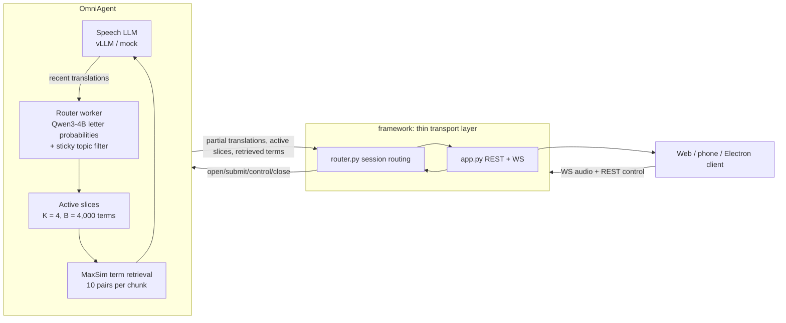

# AutoTerm-SST

**Terminology-aware streaming speech translation with no glossary upload and
no domain selection.**

AutoTerm-SST translates live speech in term-dense domains such as academic
talks, medicine, law, and finance. It builds on RASST (Retrieval-Augmented
Simultaneous Speech Translation), which needs a user glossary before each
session. AutoTerm-SST removes that step. An offline terminology catalog is
split into topic slices of 1,000 terms each. While a session runs, a small
language model (Qwen3-4B-Instruct-2507) reads the last four translated chunks
and scores every slice by the probability of its option letter. A sticky
topic filter turns these scores into a posterior over topics, and term
retrieval searches only the most probable slices: at most four slices and
4,000 terms. Up to 10 retrieved term pairs enter the prompt of each chunk.
The web UI shows the active slices with their posterior probabilities and the
retrieved term pairs next to each partial translation.

## Try it

- **Paper:** *AutoTerm-SST: Adaptive Terminology Memory with Zero Session-Time
  Setup for Streaming Speech Translation*, arXiv preprint
  [arXiv:2610.26865](https://arxiv.org/abs/2610.26865) ([PDF](https://arxiv.org/pdf/2610.26865)).
- **Hosted entry page:** <https://luojiaxuan.github.io/autoterm-sst/>.
- **Phone app:** the web interface of a running server installs on iOS and
  Android (see [Phone app](#phone-app)).
- **Screencast:** [`docs/demo_screencast.mp4`](https://github.com/luojiaxuan/autoterm-sst/blob/main/docs/demo_screencast.mp4)
  (2.5 min, recorded with an earlier version of the interface).
- **Mock mode:** one command runs the full web UI and wire protocol on a
  laptop with no GPU and no model download ([Quick start](#quick-start)).
- **Paper configuration:** `scripts/start_autoterm_demo.sh` serves the
  evaluated system and its web UI on one port ([below](#paper-configuration-gpu)).

## Results

| Setting | AutoTerm-SST | Reference |
| --- | --- | --- |
| 4.7-hour English-to-Chinese stream, five ACL 60/60 talks alternating with five oncology lectures: terminology accuracy | 87.7% | 87.5% for a system told each talk's domain |
| Same stream against a one-million-entry merged glossary | +3.3 accuracy points, +2.31 BLEU | paired by talk, p = 0.031 and p = 0.002 |
| Ten-domain RealSI streams: share of audio chunks whose correct slice is searchable | 89.7% | 78.8% for an embedding-similarity router with tuned confirmation rules |

The result files and the scripts that produce them are listed under
[Evaluation](#evaluation).

---

## How it works



- **Language-model router**
  (`framework/agents/term_memory/language_model_router.py`). Each slice has a
  short prototype description (`configs/router_prototypes_generated_s0.json`).
  The router asks Qwen3-4B which topic the recent translation belongs to and
  reads the probability of each option letter as the first answer token,
  averaged over the original and the reversed option order.
- **Sticky topic filter** (`filter_step` in the same file). A hidden Markov
  filter treats these probabilities as observations. Its one parameter is the
  per-chunk topic switch rate (1e-3 by default), so the posterior stays on the
  current topic until the evidence for a new one accumulates.
- **Budgeted retrieval.** Retrieval searches the slices with the highest
  posterior probability, at most four slices and 4,000 terms, so the retrieval
  and prompt budgets stay fixed as the catalog grows.
- **Background router worker** (`_router_loop` and `_refresh_context_scores`
  in `framework/agents/omni.py`). Routing updates run every 5 seconds and score
  all due sessions in one batch, so no chunk waits for the router.
- **Thin framework, swappable agents.** The framework (`framework/`) handles
  WebSocket and REST transport, session lifecycle, and `agent_type` routing.
  Models, prompting, batching, and retrieval live inside the agent behind the
  small contract in `framework/agent.py`.

The earlier embedding-similarity router with confirmation rules remains
available as a baseline (`--autoterm-context-scorer embedding`).

---

## Quick start

### Mock mode (no GPU)

```bash
python3 -m venv .venv
.venv/bin/python -m pip install -r requirements-mock.txt
RASST_DEMO_MOCK=1 PORT=8000 bash start_demo.sh
# open http://127.0.0.1:8000/
```

`start_demo.sh` resolves the repository from its own location and uses
`.venv/bin/python` when present. Mock mode replaces the speech LLM and the
retriever with deterministic CPU stand-ins and does not load the router model,
so you can run the whole `/init` → `/wss` → translate → `/delete_session`
flow, the web UI, and the JSON evidence stream on a laptop. The topic
posterior appears only in the GPU configuration.

### Paper configuration (GPU)

`scripts/start_autoterm_demo.sh` serves the configuration evaluated in the
paper, with the web UI on the same port: ten 1,000-term topic slices, the
Qwen3-4B router with the sticky filter (switch rate 1e-3), at most four active
slices within 4,000 terms, a four-chunk router context, routing updates every
5 seconds, and at most 10 term pairs per prompt.

```bash
MODEL=<RASST speech LLM> RETRIEVER=<rasst-hn1024.pt> \
RETRIEVER_CODE=<RASST retriever code> MANIFEST=<topic-slice manifest> \
PORT=8000 bash scripts/start_autoterm_demo.sh
```

The script header lists the optional overrides (GPUs, memory fraction, router
model and device, prototypes, slice ids). The topic slices with their MaxSim
indexes, the ACL 60/60 segments, and the speech LLM adapter are public on
Hugging Face; the Source of Truth table in
[`docs/llm_router_20261120/README.md`](docs/llm_router_20261120/README.md)
gives each repository and revision.

### Phone app

Open the HTTPS demo page on your phone. In iOS Safari, tap **Share** and choose
**Add to Home Screen**. In Android Chrome, open the browser menu and choose
**Install app**. Installation and microphone access require HTTPS except on
localhost. The installed app uses the same server for live translation and can
open its interface offline after the first online visit.

---

## Repository layout

```
framework/                 # thin transport/session/routing layer
├── server.py              #   python -m framework.server (uvicorn launcher)
├── app.py                 #   FastAPI: REST + /wss WebSocket
├── router.py              #   AgentRouter: sessions, routing, health/config aggregation
├── agent.py               #   the Agent <-> framework contract
└── agents/
    ├── omni.py            #   OmniAgent: streaming speech LLM, router worker, retrieval
    ├── infinisst.py       #   InfiniSSTAgent: wraps the InfiniSST scheduler
    ├── term_memory/       #   language-model router, topic filter, slice manifests
    └── plugins/           #   model backends, MaxSim retrieval, prompt assembly

serve/static/              # web UI and phone app (served at / by the framework)
electron/                  # desktop client
configs/                   # router prototypes, topic taxonomy, slice settings
eval/streaming_sst/        # evaluation harnesses; evidence/ holds the paper's scripts
scripts/                   # launchers, slice builders, evaluation drivers
docs/                      # evaluation records and the screencast
tests/                     # unit and integration tests (run from the repo root)
start_demo.sh              # framework launcher (mock-friendly)
```

---

## Agents

| `agent_type` | Agent | Backend | Notes |
| --- | --- | --- | --- |
| `RASST` | `OmniAgent` | in-process vLLM, Qwen3-Omni based | streaming, batched, terminology retrieval |
| `InfiniSST` | `InfiniSSTAgent` | InfiniSST scheduler and engine | paged-attention LLM stack |
| `Qwen3-Omni` | `OmniAgent` | vLLM (`qwen3_omni` template) | model-extension entry |

`RASST_FRAMEWORK_AGENTS` selects which agents load. An omni agent can call an
external HTTP inference server instead of in-process vLLM by setting its
template's `backend_kind` to `sglang_http`.

---

## Configuration

The paper configuration is set by the flags in
`scripts/start_autoterm_demo.sh`:

| Setting | Flag | Value |
| --- | --- | --- |
| Slice scorer | `--autoterm-context-scorer` | `language_model` (`embedding` for the similarity baseline) |
| Router model | `--autoterm-context-language-model` | `Qwen/Qwen3-4B-Instruct-2507` |
| Topic switch rate | `--autoterm-switch-rate` | `1e-3` (0 disables the filter) |
| Slice selection | `--autoterm-policy` | `budgeted_top_slices` |
| Active slices / term budget | `--autoterm-max-active-slices` / `--autoterm-term-budget` | 4 / 4,000 |
| Router context | `--autoterm-context-window-chunks` | 4 chunks |
| Routing update interval | `--autoterm-update-sec` | 5 s |
| Term pairs per prompt | `--rag-top-k` | 10 |

`start_demo.sh` reads environment variables instead:

| Var | Default | Meaning |
| --- | --- | --- |
| `RASST_DEMO_MOCK` | `0` | `1` runs with no GPU or model |
| `RASST_FRAMEWORK_AGENTS` | `InfiniSST,RASST` (mock: `RASST`) | agents to load |
| `RASST_FRAMEWORK_DEFAULT_AGENT` | `RASST` | agent for a blank or unknown `agent_type` |
| `HOST` / `PORT` | `127.0.0.1` / `8000` | bind address |
| `RASST_VLLM_TP_SIZE` | `1` | tensor-parallel GPUs for vLLM |
| `RASST_GPU_MEMORY_UTILIZATION` | `0.86` | vLLM memory fraction per GPU |
| `RASST_HN1024_RETRIEVER` | `checkpoints/retriever/rasst-hn1024.pt` | retriever checkpoint |
| `RASST_TERM_MEMORY_MANIFEST` | none | topic-slice manifest |

---

## HTTP / WebSocket API

| Method | Path | Purpose |
| --- | --- | --- |
| `GET` | `/` | web UI (`serve/static/index.html`) |
| `GET` | `/config` | agent capabilities (models, language pairs, presets) |
| `GET` | `/health` | agent health, including the terminology memory |
| `POST` | `/init` | open a session (`agent_type`, `language_pair`, ...) and return `session_id` |
| `WS` | `/wss/{session_id}` | stream float32 PCM (16 kHz mono) up and receive text down; `EOF` ends input |
| `POST` | `/reset_translation`, `/update_latency`, `/glossary/build`, `/ping`, `/delete_session` | session control |
| `GET` | `/queue_status/{session_id}` | admission and queue info |

By default the WebSocket sends plain text (errors as `ERROR: ...`, end of file
as `PROCESSING_COMPLETE: ...`). Add `?event_format=json` to the URL for
structured events `{"type", "text", "meta"}`, where `type` is `partial`,
`final`, `status`, or `error`. `meta` carries the retrieved term pairs
(`references`), retrieval and generation latency (`retrieve_s`, `elapsed_s`),
and the router state (`topic`). With the language-model router,
`topic.top_slices` lists the active slices with their posterior probabilities.

---

## Adding topic slices

A topic slice is one glossary file plus its MaxSim index, registered in a
manifest that the agent reads. Manifests, snapshots, and indexes live under a
runtime root outside the repository.

```bash
# 1. normalize a Wikidata-derived glossary, then filter and rank it
python scripts/term_memory/extract_wikidata_terms.py --glossary <wiki_glossary.json> \
    --target-lang zh --out rows.en-zh.jsonl
python scripts/term_memory/filter_terms.py --in rows.en-zh.jsonl --target-lang zh \
    --limit 1000 --out aviation_core_1k.json

# 2. build the MaxSim index (GPU, RASST text encoder)
python <RASST>/retriever/build_maxsim_index.py --model-path checkpoints/retriever/rasst-hn1024.pt \
    --glossary-path aviation_core_1k.json --output-path <root>/indexes/aviation_core_1k/en-zh/maxsim.pt --device cuda:0

# 3. write terms.jsonl and publish a manifest entry for the slice
python scripts/term_memory/build_term_memory_snapshot.py --glossary aviation_core_1k.json \
    --snapshot-id aviation_core_1k --langs zh --preset-id aviation_core_1k \
    --root <root> --maxsim-index zh=<root>/indexes/aviation_core_1k/en-zh/maxsim.pt
```

Add a prototype entry for the new topic to the prototypes file, which is keyed
by topic (see `configs/router_prototypes_generated_s0.json`), and pass the
slice id to the launcher through `SLICES`. Sessions keep the catalog snapshot
from their start.

---

## Evaluation

The paper's numbers come from the scripts in `eval/streaming_sst/evidence/`.
Their outputs and run provenance are in `docs/`:

| Result | Scripts | Outputs |
| --- | --- | --- |
| Closed-loop ACL 60/60 and oncology stream: terminology accuracy, BLEU, COMET, paired tests | `paired_significance.py`, `term_free_quality.py`, `per_occurrence_terms.py`, `eval/streaming_sst/score_prompt_precision.py`, `comet_quality.py`, driven by `scripts/taurus_run3_score.sh` | [`docs/llm_router_20261120/run3/`](docs/llm_router_20261120/run3/) |
| Routing versus a merged glossary of the same catalog at 249k and 1M entries | `scripts/same_catalog/build.py`, `run_aries.sh`, `run_radix_arms.sh`, `score.sh`, `eval/streaming_sst/evidence/comet_quality.py` | [`docs/same_catalog_20261124/`](docs/same_catalog_20261124/) |
| Ten-domain RealSI routing | `realsi_eval.py`, `routing_coverage.py`, `scripts/taurus_realsi_score.sh` | [`docs/realsi_20261120/`](docs/realsi_20261120/) |
| Open-loop router replays: rapid switching, German and Japanese, close domains, live cadence | `llm_router_replay.py`, `llm_hmm_filter.py`, `llm_rapid_hmm.py`, `multilingual_router_replay.py`, `llm_fine_slices.py`, `fine_slice_replay.py`, `live_cadence_replay.py` | [`docs/llm_router_20261120/`](docs/llm_router_20261120/) |
| Single-session processing speed | `latency_means.py`, `scripts/taurus_latency_routers.sh` | `docs/llm_router_20261120/latency/` |

The test audio is not part of this repository. ACL 60/60 and RealSI are
public; the oncology lectures come from the ESO test set, which the MLLP group
distributes. `scripts/radix_stream_eval/download.py` names the five lectures and
how to prepare them.

---

## Remote access

`scripts/run_cloudflared_tunnel.sh` exposes a local server through a
Cloudflare Tunnel, with WebSockets proxied natively:

```bash
# ephemeral https://<random>.trycloudflare.com URL in the log
bash scripts/run_cloudflared_tunnel.sh

# stable hostname (after `cloudflared tunnel login` and `cloudflared tunnel create`)
CF_TUNNEL_NAME=<tunnel> CF_HOSTNAME=<hostname> bash scripts/run_cloudflared_tunnel.sh
```

If the model backend goes down while the tunnel is up, the web UI shows a
banner that points visitors to the screencast and this repository.

---

## Requirements

- **GPU (paper configuration only):** two NVIDIA GPUs for the speech LLM with
  tensor parallelism. The first GPU also holds the retriever and the 4B
  router, about 11 GB in the paper's runs; set `GPU_UTIL` so both fit.
- **Python:** a vLLM environment for the GPU configuration (`vllm>=0.13`,
  `transformers`, `torch`, `qwen_omni_utils`, `fastapi`, `uvicorn`,
  `soundfile`, `numpy`) and `requirements-mock.txt` for mock mode.
- **Node:** Electron 28+ for the optional desktop client (`package.json`).

`serve/vllm_compat` must stay on `PYTHONPATH` for any vLLM run; it avoids a
duplicate Transformers config registration in vLLM worker processes.

## Tests

```bash
.venv/bin/python -m pip install -r requirements-mock.txt pytest torch requests
.venv/bin/python -m pytest tests
```

## License

The code is released under the [MIT License](LICENSE). Model weights and the
Wikidata/Wikipedia-derived terminology resources keep their upstream licenses.

## Citation

```bibtex
@article{luo2026autoterm,
  title   = {{AutoTerm-SST}: Adaptive Terminology Memory with Zero Session-Time Setup for Streaming Speech Translation},
  author  = {Luo, Jiaxuan and Ouyang, Siqi and Li, Lei},
  journal = {arXiv preprint arXiv:2610.26865},
  year    = {2026}
}
```
